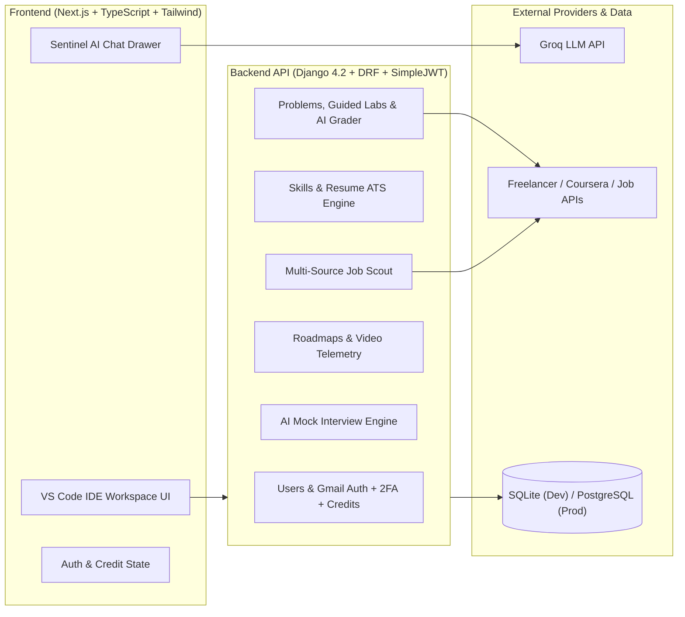

# 🐱‍🏍🐱‍💻🦾 SkillMirror  — Autonomous AI Career Intelligence & Practice Studio


**SkillMirror OS** is a full-stack AI career intelligence platform and interactive engineering practice studio. It bridges the gap between academic learning and industry readiness by combining **automated resume & skill-gap diagnostics**, **dynamic career roadmaps**, **real-world & Coursera-style guided coding labs**, **live Freelancer project requisitions**, and **autonomous AI code grading & mock interviews**.

---

## ✨ Key Platform Capabilities

### 1. 🎯 Command Center & Dual-Mode Onboarding (`/dashboard`)
- **Resume Auto-Fetch or Manual Init**: New users can either upload their existing resume (PDF/DOCX/TXT) to automatically extract their target role, skills, and experience, or configure their career goals manually in a 3-step wizard.
- **Career Digital Twin**: Real-time readiness telemetry, XP progression, level rankings, and 30-day execution plans with downloadable PDF benchmark reports.

### 2. 🧠 Skill Diagnostics & Market Intelligence
- **Skill Gap Analyzer (`/skill-gap`)**: Compares user proficiency against target role requirements to surface critical missing competencies.
- **Resume Optimizer & ATS Engine (`/resume`)**: Dynamic ATS keyword scoring, formatting analysis, AI bullet-point rewriting, and community/custom resume templates.
- **Job Market Intelligence (`/job-intelligence`)**: Live multi-source job market scraping (Remotive, Arbeitnow, Adzuna, SerpAPI) with demand velocity and salary benchmarks.

### 3. ⚡ Practice Studio & Autonomous AI Grader
- **Practice Problems (`/problems`)**:
  - **🎯 My Gap Challenges**: AI-synthesized coding & architecture challenges calibrated to your personal skill gaps.
  - **🎓 Guided Skill Labs**: Coursera-style bite-sized hands-on assignments with structured learning objectives, step-by-step instructions, starter code, and progressive hints.
  - **⚡ Freelancer Live Challenges**: Real client project briefs synced from Freelancer.com transformed into technical assessments.
  - **5-Dimension AI Auto-Grader**: Evaluates submitted code and GitHub repositories across Correctness, Code Quality, Architecture, Edge-Case Resilience, and Production Readiness.
- **AI Mock Interviews (`/mock-interview`)**: Role-calibrated technical, system design, and behavioral interviews with instant per-question AI grading, follow-up probing, and voice pace/confidence telemetry.
- **Projects & Gigs (`/projects`)**: Convert any problem or external freelance requisition into a tracked project workspace with milestone checklists and live deployment verification.

### 4. 🤖 Sentinel AI // Architect Copilot
- Floating tactical AI Career Advisor powered by **Groq (`llama-3.3-70b-versatile`)** with rich Markdown rendering (structured tables, code blocks, and actionable bullet lists).

### 5. 🔐 Enterprise Security, Gmail Auth & Credit Tiers
- **Verified Gmail Signup**: Enforces valid personal `@gmail.com` accounts upon registration.
- **Credit & Subscription System (Demo Testing Mode)**:
  - **Starter Free**: `10` free AI credits on signup.
  - **SkillMirror Plus (Demo)**: `100` AI credits/month (`₹499/mo` 1-click demo switch).
  - **SkillMirror Pro (Demo)**: `Unlimited` AI credits (`₹999/mo` 1-click demo switch).
- **Hardened Backend**: JWT token rotation, 2FA OTP with CSPRNG + 5-attempt brute-force lockout, DRF rate throttling, SSRF private/loopback IP blocking, file upload magic-byte verification, and IDOR ownership guards.

---

## 🏗️ System Architecture



---

## 🚀 Quick Start (Local Development)

### Prerequisites
- **Python** `3.11+`
- **Node.js** `18+` & `npm`
- **Groq API Key** (free at [console.groq.com](https://console.groq.com/keys))

### 1. Clone the Repository
```bash
git clone https://github.com/Varunmj12345/skillmirror.git
cd skillmirror
```

### 2. Configure Environment Variables
Create `.env` in the project root and `backend/.env`:
```env
DJANGO_SECRET_KEY=replace-with-a-strong-secret-key
JWT_SECRET=replace-with-a-strong-secret-key
DJANGO_DEBUG=True

# Groq AI Engine
GROQ_API_KEY=gsk_your_groq_api_key_here
DEFAULT_GROQ_MODEL=llama-3.3-70b-versatile
FAST_GROQ_MODEL=llama-3.1-8b-instant

# Frontend / Backend URLs
FRONTEND_URL=http://localhost:3000
NEXT_PUBLIC_API_URL=http://localhost:8000
```

### 3. Backend Setup (Django API)
```powershell
# Create and activate virtual environment
python -m venv venv
.\venv\Scripts\Activate.ps1

# Install dependencies and run migrations
cd backend
pip install -r requirements.txt
python manage.py migrate

# Start the backend server on http://127.0.0.1:8000
python manage.py runserver
```

### 4. Frontend Setup (Next.js IDE Portal)
Open a second terminal:
```powershell
cd frontend
npm install

# Start the frontend dev server on http://localhost:3000
npm run dev
```

Open **[http://localhost:3000](http://localhost:3000)** in your browser.

---

## 🧪 Running Automated Tests

To run the backend security, authentication, credit-tier, and N+1 performance regression suite:
```powershell
cd backend
..\venv\Scripts\python.exe manage.py test apps.problems apps.skills --verbosity 2
```

---

## 📁 Repository Structure

```text
skillmirror/
├── backend/
│   ├── apps/
│   │   ├── ai/            # Groq LLM dispatcher & Sentinel Career Chat
│   │   ├── alerts/        # Smart career alerts & behavioral triggers
│   │   ├── analytics/     # Readiness telemetry, learning plans & bot analytics
│   │   ├── interviews/    # AI Mock Interviews & audio pace analysis
│   │   ├── jobs/          # Multi-source job scraper & Career Scout agent
│   │   ├── problems/      # Practice challenges, Guided Skill Labs, Freelancer sync & AI Grader
│   │   ├── roadmaps/      # Personalized career roadmaps & YouTube learning tracker
│   │   ├── skills/        # Skill gap matrix, resume parser, ATS scorer & templates
│   │   └── users/         # Custom User model, Gmail signup, 2FA, RBAC & Demo Subscriptions
│   ├── skillmirror/       # Django settings, security middleware & root URLs
│   └── manage.py
├── frontend/
│   ├── src/
│   │   ├── components/    # IDE sidebar (Header.tsx), Sentinel ChatUI, Digital Twin & charts
│   │   ├── context/       # AuthContext, ThemeContext & global providers
│   │   ├── pages/         # Next.js routes (/dashboard, /problems, /projects, /resume, etc.)
│   │   └── services/      # Axios API client & domain service modules
│   └── package.json
└── infra/
    ├── docker-compose.yml
    └── k8s/
```

---

## 📄 License
Built for educational and career acceleration purposes.
